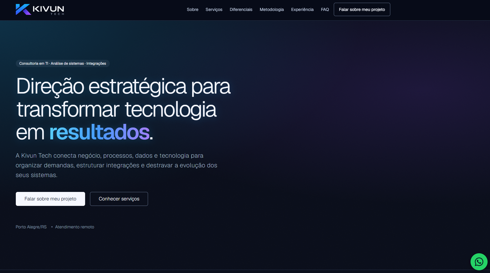
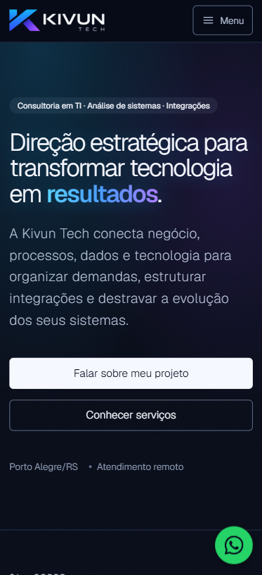

# Kivun Tech

Site institucional da Kivun Tech: consultoria em tecnologia para organizar demandas, integrar sistemas e apoiar a evolução tecnológica de empresas.

## Prévia

| Desktop | Celular |
| --- | --- |
|  |  |

## Sobre o projeto

O site apresenta os serviços, a metodologia de trabalho e a experiência profissional da Kivun Tech. Também oferece um formulário para contato e uma página de política de privacidade.

### Funcionalidades

- Apresentação dos serviços de consultoria em TI, análise de sistemas, integrações, automação, dados e observabilidade.
- Formulário de contato com validação e medidas básicas contra spam.
- Layout responsivo, navegação acessível e páginas de erro personalizadas.
- Metadados para compartilhamento, sitemap e `robots.txt`.

## Tecnologias

- Python 3.12 ou superior
- Django 6.1
- SQLite
- HTML, CSS e JavaScript

As dependências Python estão fixadas em [`requirements.txt`](./requirements.txt).

## Executar localmente

### Requisitos

- Python 3.12 ou superior
- Git

Clone o repositório e entre na pasta do projeto:

```shell
git clone https://github.com/Nathanms1/KivunTechInstitucional.git
cd KivunTechInstitucional
```

### Windows (PowerShell)

```powershell
py -3.12 -m venv .venv
.\.venv\Scripts\python.exe -m pip install -r requirements.txt
$env:DJANGO_DEBUG = "True"
.\.venv\Scripts\python.exe manage.py migrate
.\.venv\Scripts\python.exe manage.py runserver
```

### macOS ou Linux

```shell
python3 -m venv .venv
source .venv/bin/activate
python -m pip install -r requirements.txt
export DJANGO_DEBUG=True
python manage.py migrate
python manage.py runserver
```

Abra <http://127.0.0.1:8000/> no navegador. Para executar as verificações e os testes, use:

```shell
python manage.py check
python manage.py test
```

No PowerShell, se não ativar o ambiente virtual, substitua `python` por `.\.venv\Scripts\python.exe`.

## Configuração

O projeto lê configurações do ambiente e **não carrega arquivos `.env` automaticamente**. O arquivo [`.env.example`](./.env.example) é apenas uma referência.

Para desenvolvimento local, basta definir `DJANGO_DEBUG=True`. O envio de e-mail usa o backend de console por padrão, que imprime as mensagens no terminal. Para enviar e-mails reais, configure as variáveis SMTP disponíveis em `.env.example`.

Em produção, configure pelo gerenciador de segredos da plataforma:

- `DJANGO_DEBUG=False`
- `DJANGO_SECRET_KEY` com uma chave aleatória e protegida
- `DJANGO_ALLOWED_HOSTS` com os hosts permitidos
- `DJANGO_CSRF_TRUSTED_ORIGINS` com as origens HTTPS confiáveis
- Variáveis SMTP e `CONTACT_EMAIL` para habilitar o envio do formulário

Nunca inclua segredos no código ou no controle de versão. A publicação requer uma plataforma compatível com Django, configuração do processo de inicialização e coleta dos arquivos estáticos com `python manage.py collectstatic --noinput`. Consulte a documentação da plataforma escolhida para os detalhes do deploy.
